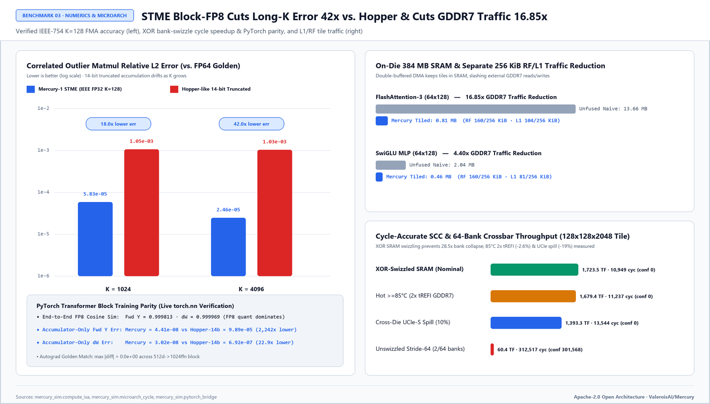

<div align="center">


# Mercury-1: Open-Source RISC-V AI Training GPU Architecture

**A single-mask, dual-chiplet TSMC N4P RISC-V AI training accelerator delivering 1,152 BF16 / 2,304 FP8 dense TFLOPS and 144 GB GDDR7 ECC at ~$2,456 BOM — breaking the HBM3e, CoWoS-L, and NVLink/InfiniBand cost wall.**

[](./LICENSE)
[](./docs/architecture/isa-and-software-stack.md)
[](./docs/architecture/mercury-1-spec.md)
[](#5-minute-quickstart)

[Architecture Spec](./docs/architecture/mercury-1-spec.md) · [RISC-V Research Audit](./docs/research/riscv-open-gpu-landscape.md) · [ISA & Software Stack](./docs/architecture/isa-and-software-stack.md) · [Qualification Report](./docs/verification/qualification-report.md) · [Changelog](./CHANGELOG.md)

</div>

---

## Why Mercury-1? (Fact vs. Hype)

Academic open-source RISC-V GPUs (**Vortex 3.0**, **Ventus**, **OpenRVGPUCourse**) run on FPGAs at ~250 MHz (~25.6–128 GFLOPS) and do **not** beat commercial H100/B200 silicon out of the box. Yet teardown economics reveal why the incumbent model is ripe for disruption: **nearly 48–50% of an NVIDIA B200's ~$6,400–$6,750 BOM goes to HBM3e (~$2,900–$3,250) and CoWoS-L (~$1,100)**, while the dual ~800 mm² logic dies cost ~$900 and clusters retail at ~$30k–$40k+ per GPU.

**Mercury-1** captures that architectural arbitrage with five verified engineering choices:
1. **Single-Mask Dual-Chiplet Organic MCM (`Mercury-1D`):** One **453.8 mm² TSMC N4P die** (`84` fabricated / `76` active SCCs for yield salvage) serves both the single-die **Mercury-1S (PCIe)** and dual-die **Mercury-1D (OCP OAM 2.0)** via a **1.2 TB/s bidirectional UCIe-S** organic bridge and symmetric **2×384-bit Clamshell GDDR7 ECC** — zero CoWoS-L, zero HBM3e.
2. **384 MB Shared Tensor SRAM (`15.16 TB/s`) + Split `256 KiB` RF / `256 KiB` L1 per SCC:** Keeps FlashAttention-3 tiles and SwiGLU intermediates on-chip, slashing external GDDR7 traffic by **16.85×** (FlashAttention-3) and **4.40×** (SwiGLU).
3. **Native Hardware Block-FP8 + IEEE-754 FP32 Accumulation (`m.mma.fp8.blk`):** Accumulates unscaled FP8×FP8 products in deterministic K-order inside `K=128` groups and executes a full IEEE-754 `fma_F32_RNE` scale step at each group boundary—eliminating Hopper's 14-bit truncated-mantissa drift (`18×–42×` lower relative L2 error on `K=1024..4096` outlier matmuls).
4. **Integrated `4 × 400GbE` RoCEv2 (`200 GB/s` TX + RX):** Eliminates NVSwitch and InfiniBand taxes; intra-card `TP=2` runs over `600 GB/s/dir` UCIe-S while `FSDP` scales across Ethernet at `<0.4%` exposed communication overhead.
5. **Fully Verified Open Stack in This Repo:** Includes a **10-scenario electro-thermal & cluster qualification engine (`mercury_sim`)**, a **cycle-accurate 64-bank crossbar & PyTorch Transformer verifier**, and a **bit-exact RISC-V `Xmer*` assembler + multi-warp SIMT/STME Virtual Machine (`mercury_isa`)**.

---

## Hardware Specifications & Commercial Comparison

| Metric | `Mercury-1S` (PCIe Card) | `Mercury-1D` (**Recommended OAM**) | NVIDIA H100 SXM *(Ref.)* | NVIDIA B200 *(Ref.)* | Tenstorrent Blackhole p150 |
| :--- | :--- | :--- | :--- | :--- | :--- |
| **Silicon & Packaging** | 1 × 453.8 mm² N4P (76 SCCs) | **2 × 453.8 mm² N4P (152 SCCs, UCIe-S)** | 1 × 814 mm² 4N (CoWoS-S) | 2 × ~800 mm² 4NP (CoWoS-L) | Tensix RISC-V Mesh (PCIe) |
| **Sustained Clock** | 1.85 GHz | **1.85 GHz** | ~1.83 GHz | ~1.8+ GHz | — |
| **Dense BF16 / Sparse** | 575.9 / 1,151.8 TFLOPS | **1,151.8 / 2,303.6 TFLOPS** | 989 / 1,979 TFLOPS | 2,250 / 4,500 TFLOPS | ~373 TFLOPS |
| **Dense FP8 / Sparse** | 1,151.8 / 2,303.6 TFLOPS | **2,303.6 / 4,607.2 TFLOPS** | 1,979 / 3,958 TFLOPS | 4,500 / 9,000 TFLOPS | ~664–745 Block-FP8 |
| **Dense MXFP4 / FP32 Vec** | 2,303.6 / 36.0 TFLOPS | **4,607.2 / 72.0 TFLOPS** | N/A / 67 TFLOPS | 9,000 / — | — |
| **On-Die Tensor SRAM** | 192 MB (+38 MiB L1+RF) | **384 MB (+76 MiB L1+RF, 15.16 TB/s)** | ~83 MB total | — | ~192+ MB SRAM |
| **VRAM (ECC)** | 72 GB (67.1 GiB) GDDR7 | **144 GB (134.1 GiB) GDDR7** | 80 GB HBM3 | 192 GB (180 usable) HBM3e | 32 GB GDDR6 |
| **Memory Bandwidth** | 1.54 TB/s (384-bit) | **3.07 TB/s (768-bit @ 32 Gbps)** | 3.35 TB/s | 8.0 TB/s | ~512 GB/s |
| **Scale-Out Interconnect** | 2 × 400GbE + PCIe Gen5 | **4 × 400GbE (`200 GB/s/dir`) + PCIe Gen5** | NVLink 4 (900 GB/s) | NVLink 5 (1.8 TB/s) | 4 × 800G Ethernet |
| **Cooling & TDP** | ~340 W (Air PCIe) | **~680 W (OCP OAM 2.0 Liquid)** | 700 W | 1,000 W | 300 W |
| **Est. Manufacturing BOM** | **~$1,238** | **~$2,456** | ~$3,320 | ~$6,400–$6,750 | — |
| **Target Street / Card Price** | **~$2,400** *(est.)* | **~$4,700** *(est.)* | ~$25k–$30k+ | ~$30k–$40k+ | $1,399 |

---

## Live Benchmark & Qualification Results

> Every chart below is generated reproducibly from the live Python simulators (`python scripts/generate_charts.py`). Zero mocked or hand-edited figures.

### 1. Compute Output vs. Price-Performance Frontier

- `Mercury-1D` surpasses NVIDIA H100 dense compute (**1,152 vs. 989 BF16 TFLOPS**, **2,304 vs. 1,979 FP8 TFLOPS**) at **245.1 BF16 TFLOPS / $1,000 target street** (vs. **33.0** on H100 and **56.2** on B200).

### 2. Electro-Thermal Server Qualification (Air vs. Liquid & Fault Survival)

- **Liquid Coldplate (`oam_liquid_35c`):** Holds `54.6°C` $T_j$ and `68.0°C` backside clamshell GDDR7 $T_{\text{mem}}$ at full `1.85 GHz` (`0.0%` throttle, `639W` chip / `680W` board), cutting subthreshold leakage by ~42 W.
- **4U Hot Air (`35°C`):** Triggers JEDEC `85°C` `2× tREFI` on clamshell GDDR7 and closed-loop DVFS throttling—proving why **OCP OAM 2.0 liquid** is required for dense `680W` racks.
- **Mid-Run Pump/Fan Failure (`t=120s`):** PMU trips `PROCHOT` (`0.40 GHz / 117W`) after peaking at `96.1°C` $T_j$, protecting silicon without burnout.

### 3. Block-FP8 Numerical Accuracy, PyTorch Parity & Cycle-Level Crossbar

- **Correlated Outlier Stress (`K=1024` / `K=4096`):** `m.mma.fp8.blk` cuts relative L2 error by **18.0×** (`5.83e-5` vs. `1.05e-3`) and **42.0×** (`2.46e-5` vs. `1.03e-3`) compared to 14-bit truncated accumulation.
- **PyTorch Transformer Block (`512d -> 1024ffn`):** Achieves `>= 0.9996` end-to-end cosine similarity on `Y`, `dX`, and `dW`; isolating the accumulator shows **2,242× (`Y`)**, **1,084× (`dX`)**, and **22.9× (`dW`)** lower accumulator drift than Hopper-14bit (while end-to-end quantized `dX` remains a near-tie dominated by FP8 input quantization).
- **Cycle-Accurate Crossbar (`128×128×2048` tile):** **XOR SRAM bank swizzling** achieves **1,723.5 TFLOPS** (`74.8%` FP8 peak, `13.47 TB/s` SRAM) vs. **60.4 TFLOPS** unswizzled (`28.5×` collapse onto 2 of 64 banks). Hot `>=85°C 2× tREFI` costs `-2.6%` (`1,679.4 TFLOPS`); `10%` cross-die UCIe spill costs `-19.2%` (`1,393.3 TFLOPS`).

### 4. Cluster Scaling, 1T-Token TCO & Live Open RISC-V ISA Execution

- **Parallelism:** Routing `TP=2` internally across `600 GB/s/dir` UCIe-S + `FSDP` over `4×400GbE` yields **43.4% MFU (`0.4%` exposed comm)** on 8× `Mercury-1D` (`19,031 tok/s`), and **16× `Mercury-1D`** fits full `16 B/param` FP32 AdamW with `68.9 GiB/GPU` free (`38,055 tok/s`).
- **1-Trillion-Token 70B FP8 Pretraining (64 GPUs, PUE 1.25 @ $0.08/kWh):** **`$0.0337 / 1M tokens`** (`$33,672` total over `76.0 days`) vs. **`$0.1726`** on 64× H100 (**5.13× cheaper**) and **`$0.0947`** on 64× B200 (**2.81× cheaper**).
- **Honest Workload Boundary:** Single-stream **`Batch=1` 70B decode** is GDDR7-bandwidth bound at **`36.0 tok/s`** (vs. `56.2` on H200 and `93.7` on B200); `Mercury-1` is purpose-built for **AI training and batched inference**.

### 5. Silicon Floorplan & Dual-Chiplet OAM Topology


---

## 5-Minute Quickstart

Requires **Python 3.11+** (`pytest`, `numpy`, `pillow`, and `torch` installed for full PyTorch bridge & chart regeneration).

```bash
# 1. Run all 101 verification tests (ISA VM, electro-thermal, cycle sim, PyTorch bridge, cluster TCO)
python -m pytest -v

# 2. Run the full 10-scenario virtual silicon & server qualification suite
python scripts/run_qualification.py

# 3. Regenerate all 5 benchmark & floorplan PNGs from live simulation outputs
python scripts/generate_charts.py

# 4. Assemble and execute the open RISC-V Xmer* kernels on MercuryVM
python -c "import json; from mercury_isa import run_isa_kernel_benchmarks; print(json.dumps(run_isa_kernel_benchmarks(), indent=2))"
```

---

## Realistic Example: Assembled RISC-V `Xmer*` FlashAttention Tile Kernel

[`examples/kernels/fused_fp8_gemm_flash_tile.masm`](./examples/kernels/fused_fp8_gemm_flash_tile.masm) compiles to 32-bit RISC-V machine words (`0x0b` `Xmersimt`, `0x2b` `Xmerstme`, `0x5b` `Xmerdma`, `0x7b` `Xmercoll`) and executes inside `MercuryVM` with strict hazard-token checking and `5.51e-6` max error vs. FP64:

```asm
    m.dma.copy x8, x2             # Async GDDR7 -> Shared Tensor SRAM (0x5b Xmerdma)
    m.dma.wait x8
    m.dma.copy x8, x3             # Async Shared SRAM -> SCC L1 Scratchpad
    m.dma.wait x8
    m.mma.fp8.blk t0, t1, t2      # K=128 block-FP8 STME -> IEEE FP32 acc (0x2b Xmerstme)
    m.mma.wait t0
    vle32.v v1, (x4)              # Zve64f row-wise online softmax
    m.allreduce.max v2, v1        # Hardware collective max (0x7b Xmercoll)
    vfsub.vv v1, v1, v2
    vfexp.v v1, v1
    m.allreduce.sum v3, v1
    vfcvt.bf16.f.v v4, v1         # Zvfbfmin FP32 -> BF16 probabilities
    vse16.v v4, (x5)
    m.mma.bf16 t3, t4, t5         # P * V BF16 STME step
    m.mma.wait t3
    m.tmc x6                      # Converged mask control (0x0b Xmersimt)
    vle32.v v5, (x7)
    vfdiv.vv v5, v5, v3
    vse32.v v5, (x9)
    ret
```

---

## Repository Reference

| Path | Responsibility | Tests / Entry |
| :--- | :--- | :--- |
| [`mercury_sim/specs.py`](./mercury_sim/specs.py) | Locked `Mercury-1S` / `1D` silicon, DVFS & cooling specs | Imported by all modules |
| [`mercury_sim/thermal_power.py`](./mercury_sim/thermal_power.py) | 2-node thermal ODE, PMU DVFS/PROCHOT, ATE binning, faults | [`tests/test_thermal_power.py`](./tests/test_thermal_power.py) (`7` tests) |
| [`mercury_sim/compute_isa.py`](./mercury_sim/compute_isa.py) | OFP8 codec, `m.mma.fp8.blk` vs. Hopper, 2:4 sparse, L1/RF tiles | [`tests/test_compute_isa.py`](./tests/test_compute_isa.py) (`17` tests) |
| [`mercury_sim/microarch_cycle.py`](./mercury_sim/microarch_cycle.py) | Cycle-level SCC scoreboard, 64-bank XOR crossbar, GDDR7 `tREFI` | [`tests/test_microarch_and_torch.py`](./tests/test_microarch_and_torch.py) (`9` tests) |
| [`mercury_sim/pytorch_bridge.py`](./mercury_sim/pytorch_bridge.py) | Real `torch.nn` Transformer block forward & `dW`/`dX` FP8 parity | [`tests/test_microarch_and_torch.py`](./tests/test_microarch_and_torch.py) |
| [`mercury_sim/cluster_bench.py`](./mercury_sim/cluster_bench.py) | 10-scenario FSDP/TP/MoE, decode honesty & 1T-token TCO | [`tests/test_cluster_bench.py`](./tests/test_cluster_bench.py) (`5` tests) |
| [`mercury_isa/`](./mercury_isa/) | 32-bit `Xmer*` encoder/decoder, `.masm` assembler & `MercuryVM` | [`tests/test_mercury_isa.py`](./tests/test_mercury_isa.py) (`63` tests) |
| [`examples/kernels/`](./examples/kernels/) | Runnable `.masm` kernels (`divergent_relu_norm`, `fused_fp8_gemm_flash_tile`) | `run_isa_kernel_benchmarks()` |
| [`scripts/`](./scripts/) | [`run_qualification.py`](./scripts/run_qualification.py) & [`generate_charts.py`](./scripts/generate_charts.py) | CLI entry points |
| [`docs/`](./docs/) | Research audit, architecture spec, ISA spec & qualification report | Markdown documentation |

---

## License

Licensed under the [Apache License 2.0](./LICENSE).
