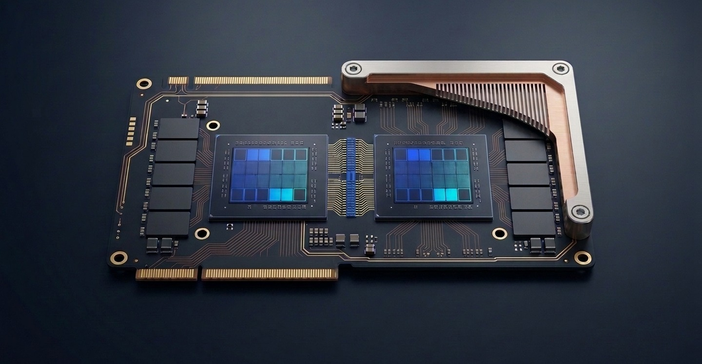
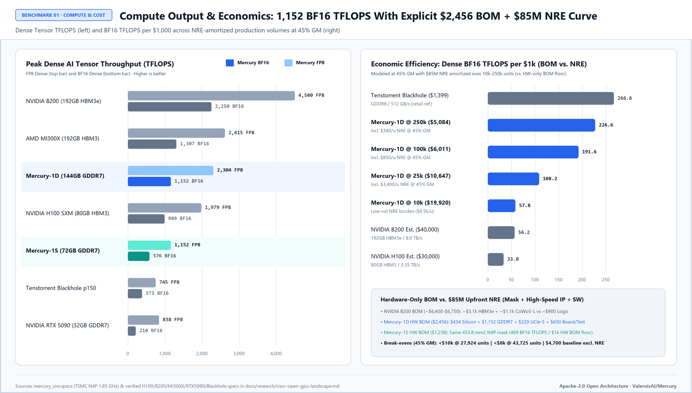
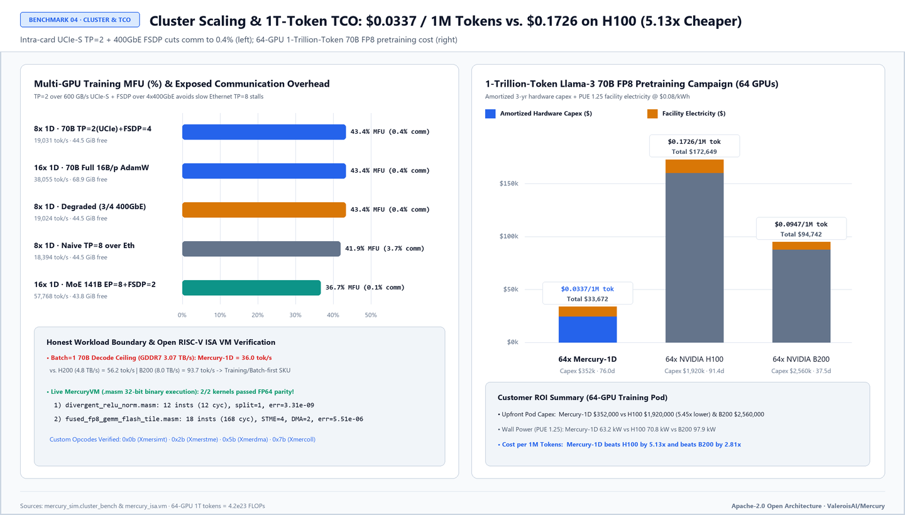
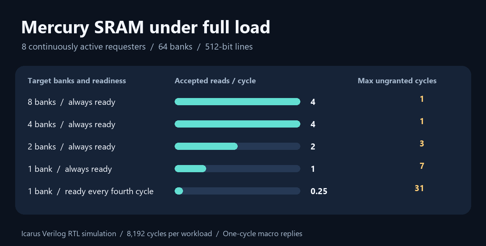

# Mercury-1

Mercury-1 is an open-source RISC-V GPU design for AI training, with runnable FP8 kernels, a functional virtual machine, and SystemVerilog prototypes.

> **Pre-silicon design.** Throughput, cost, and power figures come from design targets, analytical models, and CPU simulations.

[Quickstart](#quickstart) · [Architecture](#architecture) · [Simulation results](#simulation-results) · [RTL evidence](#rtl-evidence) · [Silicon readiness](./docs/verification/silicon-readiness.md)



**Mercury-1D design targets:** 1,152 dense BF16 TFLOPS · 2,304 dense FP8 TFLOPS · 144 GB GDDR7 ECC. Estimated hardware-only BOM: **$2,456** (excluding NRE).

## Quickstart

From the repository root, run both `Xmer*` kernels in `MercuryVM` with Python 3.11 or later. This command uses the standard library.

```sh
python -c "import json; from mercury_isa import run_isa_kernel_benchmarks; print(json.dumps(run_isa_kernel_benchmarks(), indent=2))"
```

The JSON includes the VM's estimated cycle count and error against an FP64 reference.

| Kernel | Estimated VM cycles | Max absolute error vs. FP64 |
| :--- | ---: | ---: |
| Divergent ReLU normalization | 12 | 3.31e-9 |
| Fused FP8 attention tile | 168 | 5.51e-6 |

[Walk through the FP8 attention tile](#example-fp8-attention-tile)

### Open the Workbench

Serve the checked-in qualification data, then open [the local Workbench](http://127.0.0.1:8765/dashboard/index.html).

```sh
python -m http.server 8765 --bind 127.0.0.1
```

Try **Thermal & Power → Mid-Run Fault @120s** to see how the modeled module responds to a cooling failure.

### Reproduce the qualification results

In a Python virtual environment, install the optional dependencies and run the suite. The generators write the [qualification report](./docs/verification/qualification-report.md), [benchmark charts](./assets/charts/), and Workbench data.

```sh
python -m pip install pytest numpy pillow torch
python -m pytest -q
python scripts/run_qualification.py
python scripts/generate_charts.py
python scripts/export_dashboard_data.py
```

## Architecture

Mercury-1 uses one 453.8 mm² TSMC N4P compute die design across both products, with 84 fabricated and 76 active SCCs per die. The single-die 1S is a PCIe card. The dual-die 1D pairs two dies over a 1.2 TB/s bidirectional organic UCIe-S bridge inside an **Extended OAM-L (140×185 mm)** liquid-cooled module (courtyard screening rejects 102×165 mm OAM v1.5 at 81.5% / 95.3% fill and 102×170 mm OAM r2.0 at 79.1% / 92.5% fill with 48 clamshell GDDR7 packages, while keeping a 96 GB / 32-chip OAM v1.5 configuration as a standard-slot fallback).

| Design target | 1S (PCIe) | 1D (Extended OAM-L) |
| :--- | ---: | ---: |
| Active SCCs | 76 | 152 |
| Dense BF16 (TFLOPS) | 575.9 | 1,151.8 |
| Dense FP8 (TFLOPS) | 1,151.8 | 2,303.6 |
| GDDR7 ECC (GB) | 72 | 144 |
| Bandwidth (TB/s) | 1.54 | 3.07 |
| Tensor SRAM (MB) | 192 | 384 |
| TDP target (W) | 340 | 680 |
| Est. Hardware BOM (excl. NRE) | $1,238 | $2,456 |

- **On-chip reuse.** Each SCC has a dedicated 256 KiB register file and a 256 KiB L1 scratchpad. Simulated FlashAttention-3 and SwiGLU schedules cut GDDR7 traffic by 16.85× and 4.40× against unfused baselines.
- **Block-FP8 math.** `m.mma.fp8.blk` sums products in deterministic K order and applies one IEEE-754 FP32 fused multiply-add per 128-element group.
- **Scale-out.** Mercury-1D targets four 400GbE RoCEv2 ports (200 GB/s nominal unidirectional line rate), with 600 GB/s per direction between its two dies over UCIe-S.

[Architecture spec](./docs/architecture/mercury-1-spec.md) · [ISA and software stack](./docs/architecture/isa-and-software-stack.md) · [Research and pricing assumptions](./docs/research/riscv-open-gpu-landscape.md)

<details>
<summary>Compare modeled targets with H100, B200, and Tenstorrent Blackhole</summary>

Mercury figures are modeled design targets and pre-silicon estimates. Commercial columns summarize public reference figures documented in [the research audit](./docs/research/riscv-open-gpu-landscape.md).

| Metric | `Mercury-1S` (PCIe) | `Mercury-1D` (**Extended OAM-L**) | NVIDIA H100 SXM *(Ref.)* | NVIDIA B200 *(Ref.)* | Tenstorrent Blackhole p150 |
| :--- | :--- | :--- | :--- | :--- | :--- |
| **Silicon & Packaging** | 1 × 453.8 mm² N4P (76 SCCs) | **2 × 453.8 mm² N4P (152 SCCs, UCIe-S)** | 1 × 814 mm² 4N (CoWoS-S) | 2 × ≈800 mm² 4NP (CoWoS-L) | Tensix RISC-V Mesh (PCIe) |
| **Sustained Clock** | 1.85 GHz | **1.85 GHz** | ≈1.83 GHz | ≈1.8 GHz or higher | — |
| **Dense BF16 / Sparse** | 575.9 / 1,151.8 TFLOPS | **1,151.8 / 2,303.6 TFLOPS** | 989 / 1,979 TFLOPS | 2,250 / 4,500 TFLOPS | ≈373 TFLOPS |
| **Dense FP8 / Sparse** | 1,151.8 / 2,303.6 TFLOPS | **2,303.6 / 4,607.2 TFLOPS** | 1,979 / 3,958 TFLOPS | 4,500 / 9,000 TFLOPS | ≈664–745 Block-FP8 |
| **Dense MXFP4 / FP32 Vec** | 2,303.6 / 36.0 TFLOPS | **4,607.2 / 72.0 TFLOPS** | N/A / 67 TFLOPS | 9,000 / — | — |
| **On-Die Tensor SRAM** | 192 MB (+38 MiB L1+RF) | **384 MB (+76 MiB L1+RF, 15.16 TB/s)** | ≈83 MB total | — | ≈192 MB SRAM or more |
| **VRAM (ECC)** | 72 GB (67.1 GiB) GDDR7 | **144 GB (134.1 GiB) GDDR7** | 80 GB HBM3 | 192 GB (180 usable) HBM3e | 32 GB GDDR6 |
| **Memory Bandwidth** | 1.54 TB/s (384-bit) | **3.07 TB/s (768-bit @ 32 Gbps)** | 3.35 TB/s | 8.0 TB/s | ≈512 GB/s |
| **Scale-Out Interconnect** | 2 × 400GbE + PCIe Gen5 | **4 × 400GbE (200 GB/s/dir) + PCIe Gen5** | NVLink 4 (900 GB/s) | NVLink 5 (1.8 TB/s) | 4 × 800G Ethernet |
| **Cooling & Form Factor** | ≈340 W (Air PCIe) | **≈680 W (Extended OAM-L 140×185 mm Liquid)** | 700 W | 1,000 W | 300 W |
| **Est. Hardware BOM** | **$1,238** | **$2,456** *(excl. $85M NRE)* | ≈$3,320 | $6,400–$6,750 | — |
| **Vol. Price Floor (45% GM / Ref.)** | **$2,400** *(HW-only)* | **$6,011 @ 100k vol** *($19,920 @ 10k; $4,700 excl. NRE)* | $25k–$30k+ | $30k–$40k+ | $1,399 |

</details>

## Simulation results

All charts below are generated directly from the Python simulators (`scripts/generate_charts.py`), with scenario assumptions and sensitivity bounds recorded in [the qualification report](./docs/verification/qualification-report.md).

### Compute, BOM and NRE economics

- **Peak targets:** Mercury-1D targets 1,152 dense BF16 TFLOPS and 2,304 dense FP8 TFLOPS (H100 reference: 989 / 1,979 TFLOPS).
- **Hardware BOM and NRE.** A $2,456 hardware-only BOM plus $85M in modeled NRE at a 45% gross margin yields $19,920 per card at 10k units. The modeled price drops below $10k at 27,924 units and $8k at 43,725, then reaches $6,011 at 100k and $5,084 at 250k. The 10k-unit campaign costs $0.1013 per million tokens in the model, above the B200 reference of $0.0947.

### Cooling and fault response

- **Liquid cold plate at 35°C:** Holds 1.85 GHz at 54.6°C die junction and 68.0°C backside GDDR7 temperature (639 W chip / 680 W board power).
- **4U air cooling at 35°C:** Crosses the 85°C GDDR7 double-refresh threshold (`2× tREFI`) and throttles via closed-loop DVFS.
- **Cooling fault at 120 s:** Simulated PMU trips `PROCHOT` after a 96.1°C die peak and clamps safely to 0.40 GHz and 117 W chip power.

### FP8 accuracy, training validation and SRAM crossbar

- **Long-K outlier matmul:** `m.mma.fp8.blk` cuts relative L2 error by **18.0×** at `K=1024` (`5.83e-5` vs. `1.05e-3`) and **42.0×** at `K=4096` (`2.46e-5` vs. `1.03e-3`) versus 14-bit truncated accumulation.
- **Multi-seed PyTorch validation.** Across three seeds and four activation distributions, Mercury’s first-step gradients stayed closer to the FP8 exact-accumulation control in 12 of 12 runs. Downstream requantization can amplify those differences. Quantization dominated end-to-end drift, and Mercury had lower full update drift than the Hopper approximation in 7 of 12 runs. [Reproduce the synthetic experiment](./docs/verification/fp8-training-validation.md).
- **Cycle-level architectural crossbar & A-multicast:** On `128×128`, XOR SRAM bank swizzling delivers **1,723.5 TFLOPS** (74.8% FP8 peak, 13.47 TB/s SRAM) vs. **60.4 TFLOPS** unswizzled (28.5× collapse onto 2 of 64 banks); widening to **`256×128` with an `8×19` A-operand multicast tree** lifts throughput to **2,022.0 TFLOPS** (87.8% peak, +17.3%) while reducing Shared SRAM reads 11.62 → 4.36 TB/s. Hot `>=85°C 2× tREFI` costs `-2.6%` (1,679.4 TFLOPS); 10% cross-die UCIe spill costs `-19.2%` (1,393.3 TFLOPS). The [RTL evidence](#rtl-evidence) covers the SRAM arbiter and payload path alongside the FP8, FP32, and DMA prototypes.

### Cluster scaling, fabric placement and training cost

- **Intra-card TP=2 + FSDP:** Using 600 GB/s/dir UCIe-S for `TP=2` plus `4×400GbE` for FSDP yields **43.4% MFU (0.4% exposed comm)** on 8× Mercury-1D (19,031 tok/s), while 16× Mercury-1D fits full 16 B/param FP32 AdamW with 68.9 GiB/GPU headroom (38,055 tok/s).
- **Leaf/spine ring placement ([`docs/verification/fabric-sensitivity.md`](./docs/verification/fabric-sensitivity.md), fixed 55.0 s compute budget):** Across a 64-card 2:1 oversubscribed Ethernet fabric under FSDP2 `reshard_after_forward=True` (omitting packet queues, ECMP, and PFC), `leaf_major` placement exposes **0.58%** communication (`1` busiest leaf edge, 35.3 TB inter-leaf traffic) versus **2.65%** (`8` busiest edges, 282.2 TB) when striped across leaves; deferring gradient reduction (`reduce_each_microbatch=False`) drops `leaf_major` exposure to **0.31%** at +137.8 GB of retained BF16 gradients per card before activations/optimizer state (no VRAM fit implied).
- **1-trillion-token 70B FP8 pretraining (64 GPUs, PUE 1.25 at $0.08/kWh).** Mercury-1D models **$0.0395 per million tokens** with NRE amortized over 100,000 units. The hardware baseline excluding NRE is **$0.0337 per million tokens** ($33,672 total over 76.0 days). The modeled references are **$0.1726** for H100 and **$0.0947** for B200 per million tokens. [Qualification report](./docs/verification/qualification-report.md)
- **Honest workload boundary:** Single-stream **`Batch=1` 70B decode** is GDDR7-bandwidth bound at **36.0 tok/s** (vs. 56.2 on H200 and 93.7 on B200); Mercury-1 is built for AI training and batched inference.

### Dual-chiplet floorplan and Extended OAM-L courtyard

- **PCB courtyard screen (`physical_bom.py`):** Standard 102×165 mm OAM v1.5 (81.5% top / 95.3% bottom fill) and 102×170 mm OAM r2.0 (79.1% / 92.5%) fail edge-clearance and `<75%` routing allowance checks with 48 clamshell GDDR7 packages. **Extended OAM-L (140×185 mm)** passes at 53.0% top / 61.9% bottom fill (`32.0 mm` max trace), with 96 GB / 32-chip OAM (`69.4% / 68.2%`) and 72 GB PCIe (`27.2% / 18.8%`) verified as compliant alternatives.

## Example: FP8 attention tile

[`examples/kernels/fused_fp8_gemm_flash_tile.masm`](./examples/kernels/fused_fp8_gemm_flash_tile.masm) compiles to 32-bit RISC-V machine words (`0x0b` `Xmersimt`, `0x2b` `Xmerstme`, `0x5b` `Xmerdma`, `0x7b` `Xmercoll`) and executes inside `MercuryVM` with strict hazard-token checking (`5.51e-6` max error vs. FP64):

```asm
    m.dma.copy x8, x2             # Async GDDR7 -> Shared Tensor SRAM (0x5b Xmerdma)
    m.dma.wait x8
    m.dma.copy x8, x3             # Async Shared SRAM -> SCC L1 Scratchpad
    m.dma.wait x8
    m.mma.fp8.blk t0, t1, t2      # K=128 block-FP8 STME -> IEEE FP32 acc (0x2b Xmerstme)
    m.mma.wait t0
    vle32.v v1, (x4)              # Zve64f row-wise online softmax
    m.allreduce.max v2, v1        # Hardware collective max (0x7b Xmercoll)
    vfsub.vv v1, v1, v2
    vfexp.v v1, v1
    m.allreduce.sum v3, v1
    vfcvt.bf16.f.v v4, v1         # Zvfbfmin FP32 -> BF16 probabilities
    vse16.v v4, (x5)
    m.mma.bf16 t3, t4, t5         # P * V BF16 STME step
    m.mma.wait t3
    m.tmc x6                      # Converged mask control (0x0b Xmersimt)
    vle32.v v5, (x7)
    vfdiv.vv v5, v5, v3
    vse32.v v5, (x9)
    ret
```

## RTL evidence

| Block | Reproduced evidence |
| :--- | :--- |
| [FP8 multiplication and group sum](./docs/verification/stme-group-rtl.md) | 262,144 operand and format combinations against the Python reference, plus a bounded check of the full 128-term group |
| [Pipelined FP32 group sum](./docs/verification/stme-interleaved-rtl.md) | Four-stage addition and 16 consecutive accepted inputs across eight independent contexts in a bounded handshake check |
| [Pipelined FP32 FMA](./docs/verification/stme-boundary-rtl.md#six-stage-fma-prototype) | Six stages, 30,632 arithmetic comparisons, and a reduction from 233 to 55 generic synthesis logic levels |
| [Scaled scalar FP8 dot](./docs/verification/stme-fp8-dot-rtl.md) | Two binary32 scales round once before FMA. Bounded handshake and reset checks preserve group order and an exact fused residual of `-2^-46`. |
| [64-bank SRAM arbiter](./docs/verification/shared-sram-rtl.md) | 2,056 formal equivalence points against the serial implementation and a reduction from 1,561 to 26 generic synthesis logic levels |
| [DMA tokens](./docs/verification/dma-token-rtl.md) | Bounded checks for generation-tagged completion and acquisition |
| [Banked SRAM payload](./docs/verification/sram-payload-rtl.md) | Full-size simulation with eight saturated requesters and 512-bit lines, plus bounded checks for same-cycle turnover, byte masks, stalls, and reset |
| [FPGA SRAM integration](./docs/verification/sram-bram-validation.md) | Four banks with 16 KiB total, mapping to four UltraScale+ block RAM primitives, and a simulated on-board self-test covering all 2,048 lines |

With Yosys on PATH, run the [RTL regression](./scripts/check_rtl.py) from the repository root:

```sh
python scripts/check_rtl.py
```

Use `--exhaustive --fpga` for the full FP8 product sweep, the 128-term group check, and UltraScale+ primitive mapping for eleven RTL tops. Generic logic depth and FPGA primitive counts are synthesis results. Physical timing is a separate [readiness gate](./docs/verification/silicon-readiness.md).

Add `--simulation` with Icarus Verilog on `PATH` to run the [full-load SRAM simulation](./docs/verification/sram-payload-rtl.md#full-load-simulation). Eight continuously active requesters targeting one ready bank sustained **one read per cycle**, with **at most seven ungranted cycles** per requester between grants. A bank ready every fourth cycle sustained **0.25 reads per cycle** with up to **31 ungranted cycles**. Both cases used a one-cycle macro model.



[Yosys setup](./docs/verification/shared-sram-rtl.md) · [FP32 FMA checks](./docs/verification/stme-boundary-rtl.md) · [FPGA primitive counts](./docs/verification/fpga-mapping.md) · [Silicon readiness gates](./docs/verification/silicon-readiness.md)

## Repository reference

| Module | Focus | Tests |
| :--- | :--- | :--- |
| [`specs.py`](./mercury_sim/specs.py) | `1S` / `1D` silicon, DVFS & cooling specs | Shared contract |
| [`thermal_power.py`](./mercury_sim/thermal_power.py) | 2-node thermal ODE, PROCHOT, ATE binning | [`test_thermal_power.py`](./tests/test_thermal_power.py) |
| [`physical_bom.py`](./mercury_sim/physical_bom.py) | PCB courtyard screen & $85M NRE curves | [`test_physical_bom.py`](./tests/test_physical_bom.py) |
| [`compute_isa.py`](./mercury_sim/compute_isa.py) | OFP8 codec, `m.mma.fp8.blk`, 2:4 sparse, tiles | [`test_compute_isa.py`](./tests/test_compute_isa.py) |
| [`microarch_cycle.py`](./mercury_sim/microarch_cycle.py) | Cycle-level crossbar, XOR swizzle, `256×128` multicast | [`test_microarch_and_torch.py`](./tests/test_microarch_and_torch.py) |
| [`pytorch_bridge.py`](./mercury_sim/pytorch_bridge.py) | Transformer parity, `AdamW`, multi-seed suite | [`test_training_validation.py`](./tests/test_training_validation.py) |
| [`cluster_bench.py`](./mercury_sim/cluster_bench.py) | 10-scenario FSDP/TP/MoE, decode limit & TCO | [`test_cluster_bench.py`](./tests/test_cluster_bench.py) |
| [`fabric.py`](./mercury_sim/fabric.py) | Leaf/spine ring FSDP2 placement sensitivity | [`test_fabric.py`](./tests/test_fabric.py) |
| [`rtl/`](./rtl/) | SystemVerilog prototypes for FP8/FP32 arithmetic, STME scheduling, SRAM arbitration and data routing, and DMA token control | [RTL evidence](#rtl-evidence) |
| [`mercury_isa/`](./mercury_isa/) | 32-bit `Xmer*` ISA, assembler & `MercuryVM` | [`test_mercury_isa.py`](./tests/test_mercury_isa.py) |
| [`examples/kernels/`](./examples/kernels/) | Runnable `.masm` kernels (`12` & `168` cycles) | `run_isa_kernel_benchmarks()` |
| [`dashboard/`](./dashboard/index.html) | Interactive Engineering Workbench (`DESIGN.md`) | [`export_dashboard_data.py`](./scripts/export_dashboard_data.py) |
| [`scripts/`](./scripts/) & [`docs/`](./docs/) | Report/chart generators, specs & research audit | Full pytest & Yosys scripts |

## Current scope & not yet built

- **Verified in this repository.** The Python suite covers the yield and thermal models, PCB courtyard and NRE estimates, fabric sensitivity, crossbar timing, multi-seed FP8 validation, and the `Xmer*` assembler and VM. RTL checks cover scalar FP8 arithmetic, group scheduling, SRAM bank arbitration, and the DMA token lifecycle.
- **Not yet built (next engineering milestones):**
  - Full GPU and SCC RTL, including SRAM macros, data crossbars, ECC, STME/RVV datapaths, and system-level RTL simulation.
  - TSMC N4P physical place-and-route, static timing analysis (STA) closure at 1.85 GHz, and IR-drop signoff.
  - IBIS/HSPICE signal-integrity signoff for 32 Gbps PAM3 clamshell GDDR7 channels and 400GbE SerDes.
  - Production LLVM codegen backend, Triton MLIR lowering passes, and Linux kernel / RoCEv2 user-mode driver.

## License

Licensed under the [Apache License 2.0](./LICENSE). See the [changelog](./CHANGELOG.md) for release history.
