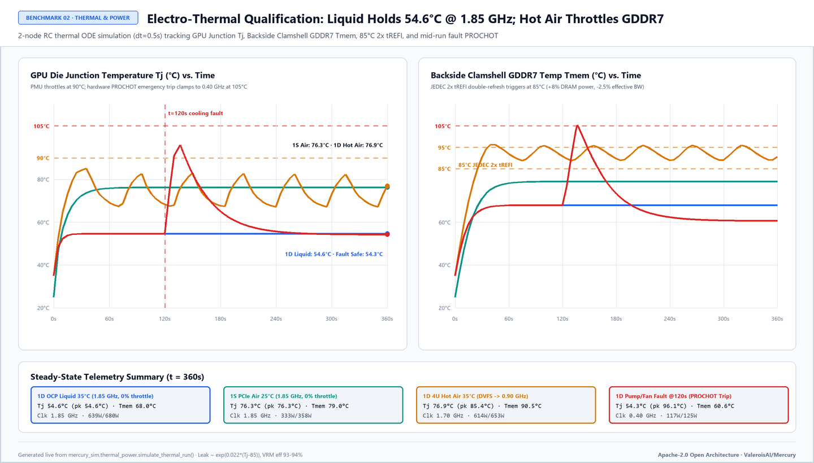
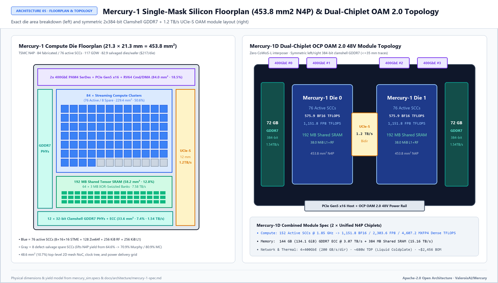

# Mercury-1

An open-source RISC-V GPU architecture for AI training, with a runnable assembler, virtual machine, and hardware simulator.

[Quickstart](#quickstart) · [Architecture spec](./docs/architecture/mercury-1-spec.md) · [Simulation results](#simulation-results)


**Mercury-1D design targets:** 1,152 dense BF16 TFLOPS · 2,304 dense FP8 TFLOPS · 144 GB GDDR7 ECC. Estimated manufacturing BOM: **$2,456**.

> Mercury-1 is a pre-silicon design. Throughput and power figures are design targets, simulations, or estimates. The tools and kernels below run on your CPU.

## Quickstart

From the repository root, run the two sample kernels in the Mercury VM with Python 3.11 or later:

```bash
python -c "
import json
import mercury_isa as mercury
results = mercury.run_isa_kernel_benchmarks()
print(json.dumps(results, indent=2))
"
```

The command prints simulator cycles and FP64 error for the divergent ReLU normalization and FP8 attention kernels. [Read the assembly walkthrough](#example-fp8-attention-tile).

<details>
<summary>Run the tests and regenerate the reports</summary>

Install the optional test and chart dependencies in your project environment, then run:

```bash
python -m pip install pytest numpy pillow torch
python -m pytest -v
python scripts/run_qualification.py
python scripts/generate_charts.py
```

The qualification command writes the [Markdown report](./docs/verification/qualification-report.md). The chart command writes the five PNGs under [`assets/charts/`](./assets/charts/).

</details>

## Architecture

Mercury-1 uses one 453.8 mm² TSMC N4P compute die design across both products, with 84 fabricated and 76 active SCCs per die. The single-die 1S is a PCIe card. The dual-die 1D pairs those dies over a 1.2 TB/s bidirectional organic UCIe-S bridge in an OAM module.

| Design target | 1S (PCIe) | 1D (OAM) |
| :--- | ---: | ---: |
| Active SCCs | 76 | 152 |
| Dense BF16 (TFLOPS) | 575.9 | 1,151.8 |
| Dense FP8 (TFLOPS) | 1,151.8 | 2,303.6 |
| GDDR7 ECC (GB) | 72 | 144 |
| Bandwidth (TB/s) | 1.54 | 3.07 |
| Tensor SRAM (MB) | 192 | 384 |
| TDP target (W) | 340 | 680 |
| Estimated BOM | $1,238 | $2,456 |

- **On-chip reuse.** Each SCC has a dedicated 256 KiB register file and a 256 KiB L1 scratchpad. The simulated FlashAttention-3 and SwiGLU schedules cut GDDR7 traffic by 16.85× and 4.40× against the unfused baseline.
- **Block-FP8 math.** `m.mma.fp8.blk` sums products in deterministic K order and applies one IEEE-754 FP32 fused multiply-add per 128-element group.
- **Scale-out.** Mercury-1D targets four 400GbE RoCEv2 ports at 200 GB/s per direction, with 600 GB/s per direction between its two dies over UCIe-S.

[ISA and software stack](./docs/architecture/isa-and-software-stack.md) · [RISC-V GPU research and pricing assumptions](./docs/research/riscv-open-gpu-landscape.md)

<details>
<summary>Compare with H100, B200, and Tenstorrent Blackhole</summary>

Mercury figures are modeled design targets and estimates. The commercial columns provide reference figures. The research audit documents the FPGA baselines and the memory and packaging cost assumptions behind the comparison.

| Metric | `Mercury-1S` (PCIe Card) | `Mercury-1D` (**Recommended OAM**) | NVIDIA H100 SXM *(Ref.)* | NVIDIA B200 *(Ref.)* | Tenstorrent Blackhole p150 |
| :--- | :--- | :--- | :--- | :--- | :--- |
| **Silicon & Packaging** | 1 × 453.8 mm² N4P (76 SCCs) | **2 × 453.8 mm² N4P (152 SCCs, UCIe-S)** | 1 × 814 mm² 4N (CoWoS-S) | 2 × ≈800 mm² 4NP (CoWoS-L) | Tensix RISC-V Mesh (PCIe) |
| **Sustained Clock** | 1.85 GHz | **1.85 GHz** | ≈1.83 GHz | ≈1.8 GHz or higher | — |
| **Dense BF16 / Sparse** | 575.9 / 1,151.8 TFLOPS | **1,151.8 / 2,303.6 TFLOPS** | 989 / 1,979 TFLOPS | 2,250 / 4,500 TFLOPS | ≈373 TFLOPS |
| **Dense FP8 / Sparse** | 1,151.8 / 2,303.6 TFLOPS | **2,303.6 / 4,607.2 TFLOPS** | 1,979 / 3,958 TFLOPS | 4,500 / 9,000 TFLOPS | ≈664–745 Block-FP8 |
| **Dense MXFP4 / FP32 Vec** | 2,303.6 / 36.0 TFLOPS | **4,607.2 / 72.0 TFLOPS** | N/A / 67 TFLOPS | 9,000 / — | — |
| **On-Die Tensor SRAM** | 192 MB (+38 MiB L1+RF) | **384 MB (+76 MiB L1+RF, 15.16 TB/s)** | ≈83 MB total | — | ≈192 MB SRAM or more |
| **VRAM (ECC)** | 72 GB (67.1 GiB) GDDR7 | **144 GB (134.1 GiB) GDDR7** | 80 GB HBM3 | 192 GB (180 usable) HBM3e | 32 GB GDDR6 |
| **Memory Bandwidth** | 1.54 TB/s (384-bit) | **3.07 TB/s (768-bit @ 32 Gbps)** | 3.35 TB/s | 8.0 TB/s | ≈512 GB/s |
| **Scale-Out Interconnect** | 2 × 400GbE + PCIe Gen5 | **4 × 400GbE (`200 GB/s/dir`) + PCIe Gen5** | NVLink 4 (900 GB/s) | NVLink 5 (1.8 TB/s) | 4 × 800G Ethernet |
| **Cooling & TDP** | ≈340 W (Air PCIe) | **≈680 W (OCP OAM 2.0 Liquid)** | 700 W | 1,000 W | 300 W |
| **Est. Manufacturing BOM** | **$1,238** | **$2,456** | ≈$3,320 | $6,400–$6,750 | — |
| **Target Street / Card Price** | **$2,400** *(est.)* | **$4,700** *(est.)* | $25k–$30k+ | $30k–$40k+ | $1,399 |

</details>

## Simulation results

These charts come from the Python simulators. The [qualification report](./docs/verification/qualification-report.md) records the ten scenarios and their assumptions.

### Compute and cost

- The Mercury-1D design targets **1,152 dense BF16 TFLOPS** and **2,304 dense FP8 TFLOPS**, compared with H100 reference figures of 989 and 1,979. At the estimated street price, that yields **245.1 dense BF16 TFLOPS per $1,000** in the model.

### Cooling and fault response

- **Liquid cold plate at 35°C.** The model sustains 1.85 GHz at 54.6°C die junction and 68.0°C backside GDDR7 temperature, at 639 W chip power and 680 W board power.
- **4U air cooling at 35°C.** The model crosses the 85°C GDDR7 double-refresh threshold and throttles through DVFS.
- **Pump or fan fault at 120 s.** The simulated PMU asserts `PROCHOT` and drops to 0.40 GHz and 117 W after a peak die junction temperature of 96.1°C.

### FP8 accuracy and SRAM bandwidth

- **Correlated Outlier Stress (`K=1024` / `K=4096`):** `m.mma.fp8.blk` cuts relative L2 error by **18.0×** (`5.83e-5` vs. `1.05e-3`) and **42.0×** (`2.46e-5` vs. `1.03e-3`) compared to 14-bit truncated accumulation.
- **PyTorch Transformer Block (`512d -> 1024ffn`):** Achieves `>= 0.9996` end-to-end cosine similarity on `Y`, `dX`, and `dW`; isolating the accumulator shows **2,242× (`Y`)**, **1,084× (`dX`)**, and **22.9× (`dW`)** lower accumulator drift than Hopper-14bit (while end-to-end quantized `dX` remains a near-tie dominated by FP8 input quantization).
- **Cycle-Accurate Crossbar (`128×128×2048` tile):** **XOR SRAM bank swizzling** achieves **1,723.5 TFLOPS** (`74.8%` FP8 peak, `13.47 TB/s` SRAM) vs. **60.4 TFLOPS** unswizzled (`28.5×` collapse onto 2 of 64 banks). Hot `>=85°C 2× tREFI` costs `-2.6%` (`1,679.4 TFLOPS`); `10%` cross-die UCIe spill costs `-19.2%` (`1,393.3 TFLOPS`).

### Cluster scaling and training cost

- **Parallelism:** Routing `TP=2` internally across `600 GB/s/dir` UCIe-S + `FSDP` over `4×400GbE` yields **43.4% MFU (`0.4%` exposed comm)** on 8× `Mercury-1D` (`19,031 tok/s`), and **16× `Mercury-1D`** fits full `16 B/param` FP32 AdamW with `68.9 GiB/GPU` free (`38,055 tok/s`).
- **1-Trillion-Token 70B FP8 Pretraining (64 GPUs, PUE 1.25 @ $0.08/kWh):** **`$0.0337 / 1M tokens`** (`$33,672` total over `76.0 days`) vs. **`$0.1726`** on 64× H100 (**5.13× cheaper**) and **`$0.0947`** on 64× B200 (**2.81× cheaper**).
- **Honest Workload Boundary:** Single-stream **`Batch=1` 70B decode** is GDDR7-bandwidth bound at **`36.0 tok/s`** (vs. `56.2` on H200 and `93.7` on B200); `Mercury-1` is purpose-built for **AI training and batched inference**.

### Dual-chiplet floorplan


## Example: FP8 attention tile

[`examples/kernels/fused_fp8_gemm_flash_tile.masm`](./examples/kernels/fused_fp8_gemm_flash_tile.masm) compiles to 32-bit RISC-V machine words (`0x0b` `Xmersimt`, `0x2b` `Xmerstme`, `0x5b` `Xmerdma`, `0x7b` `Xmercoll`) and executes inside `MercuryVM` with strict hazard-token checking and `5.51e-6` max error vs. FP64:

```asm
    m.dma.copy x8, x2             # Async GDDR7 -> Shared Tensor SRAM (0x5b Xmerdma)
    m.dma.wait x8
    m.dma.copy x8, x3             # Async Shared SRAM -> SCC L1 Scratchpad
    m.dma.wait x8
    m.mma.fp8.blk t0, t1, t2      # K=128 block-FP8 STME -> IEEE FP32 acc (0x2b Xmerstme)
    m.mma.wait t0
    vle32.v v1, (x4)              # Zve64f row-wise online softmax
    m.allreduce.max v2, v1        # Hardware collective max (0x7b Xmercoll)
    vfsub.vv v1, v1, v2
    vfexp.v v1, v1
    m.allreduce.sum v3, v1
    vfcvt.bf16.f.v v4, v1         # Zvfbfmin FP32 -> BF16 probabilities
    vse16.v v4, (x5)
    m.mma.bf16 t3, t4, t5         # P * V BF16 STME step
    m.mma.wait t3
    m.tmc x6                      # Converged mask control (0x0b Xmersimt)
    vle32.v v5, (x7)
    vfdiv.vv v5, v5, v3
    vse32.v v5, (x9)
    ret
```

## Repository reference

| Path | Responsibility | Tests / Entry |
| :--- | :--- | :--- |
| [`mercury_sim/specs.py`](./mercury_sim/specs.py) | Locked `Mercury-1S` / `1D` silicon, DVFS & cooling specs | Imported by all modules |
| [`mercury_sim/thermal_power.py`](./mercury_sim/thermal_power.py) | 2-node thermal ODE, PMU DVFS/PROCHOT, ATE binning, faults | [`tests/test_thermal_power.py`](./tests/test_thermal_power.py) (`7` tests) |
| [`mercury_sim/compute_isa.py`](./mercury_sim/compute_isa.py) | OFP8 codec, `m.mma.fp8.blk` vs. Hopper, 2:4 sparse, L1/RF tiles | [`tests/test_compute_isa.py`](./tests/test_compute_isa.py) (`17` tests) |
| [`mercury_sim/microarch_cycle.py`](./mercury_sim/microarch_cycle.py) | Cycle-level SCC scoreboard, 64-bank XOR crossbar, GDDR7 `tREFI` | [`tests/test_microarch_and_torch.py`](./tests/test_microarch_and_torch.py) (`9` tests) |
| [`mercury_sim/pytorch_bridge.py`](./mercury_sim/pytorch_bridge.py) | Real `torch.nn` Transformer block forward & `dW`/`dX` FP8 parity | [`tests/test_microarch_and_torch.py`](./tests/test_microarch_and_torch.py) |
| [`mercury_sim/cluster_bench.py`](./mercury_sim/cluster_bench.py) | 10-scenario FSDP/TP/MoE, decode honesty & 1T-token TCO | [`tests/test_cluster_bench.py`](./tests/test_cluster_bench.py) (`5` tests) |
| [`mercury_isa/`](./mercury_isa/) | 32-bit `Xmer*` encoder/decoder, `.masm` assembler & `MercuryVM` | [`tests/test_mercury_isa.py`](./tests/test_mercury_isa.py) (`63` tests) |
| [`examples/kernels/`](./examples/kernels/) | Runnable `.masm` kernels (`divergent_relu_norm`, `fused_fp8_gemm_flash_tile`) | `run_isa_kernel_benchmarks()` |
| [`scripts/`](./scripts/) | [`run_qualification.py`](./scripts/run_qualification.py) & [`generate_charts.py`](./scripts/generate_charts.py) | CLI entry points |
| [`docs/`](./docs/) | Research audit, architecture spec, ISA spec & qualification report | Markdown documentation |

## License

Licensed under the [Apache License 2.0](./LICENSE). See the [changelog](./CHANGELOG.md) for release history.
